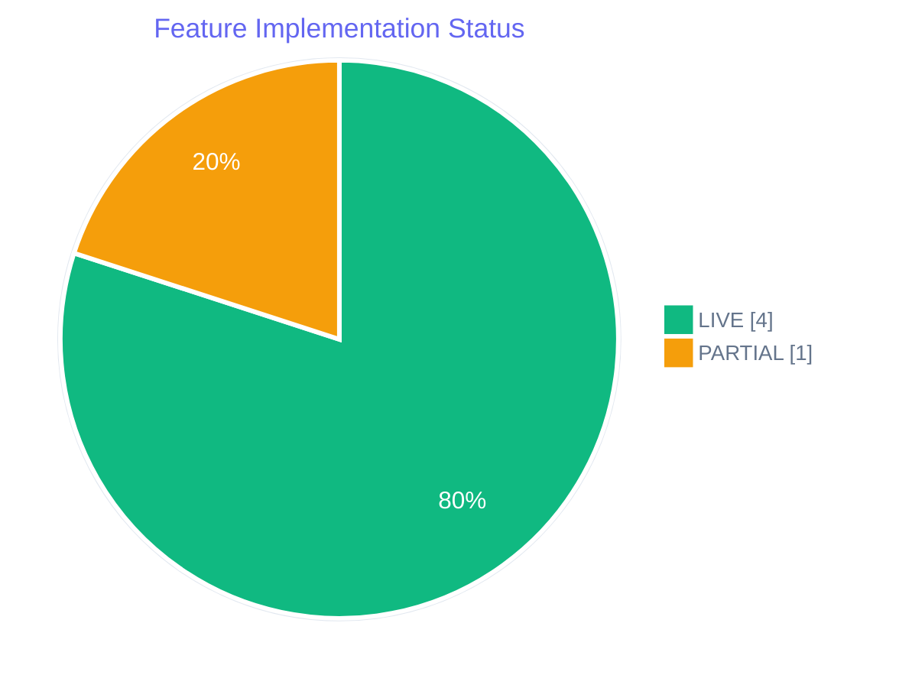
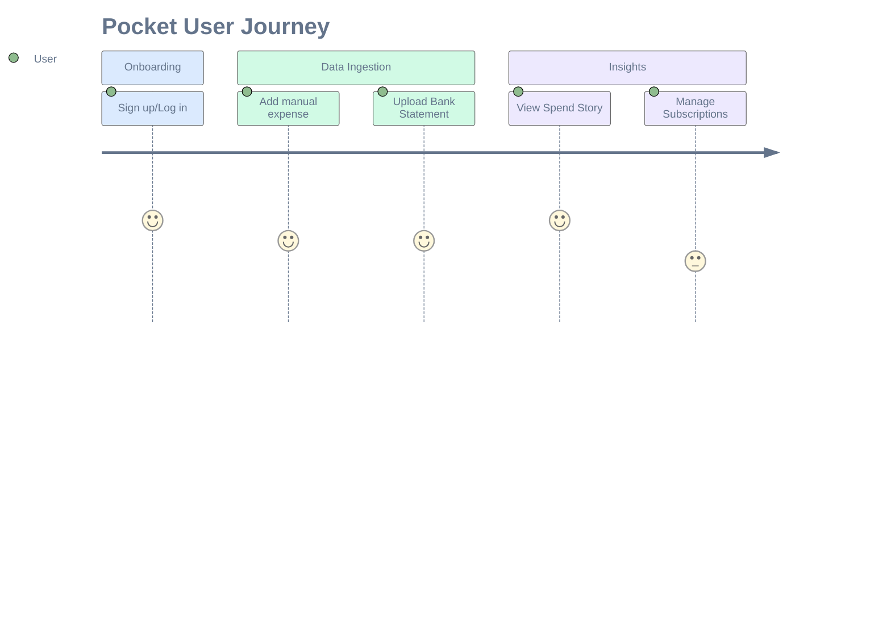
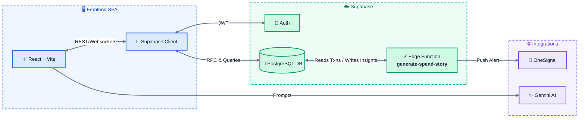
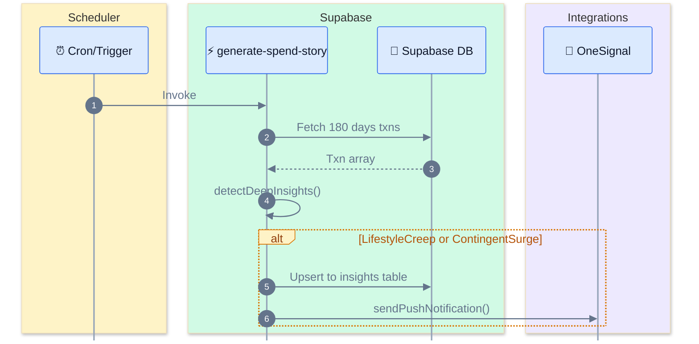
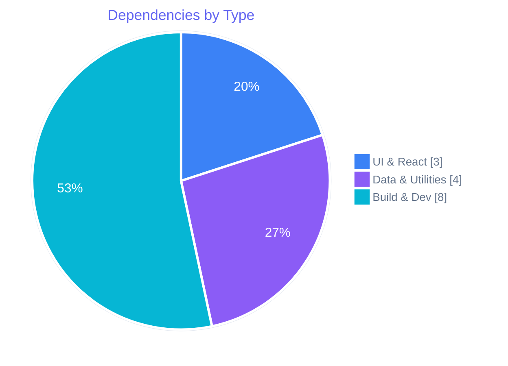
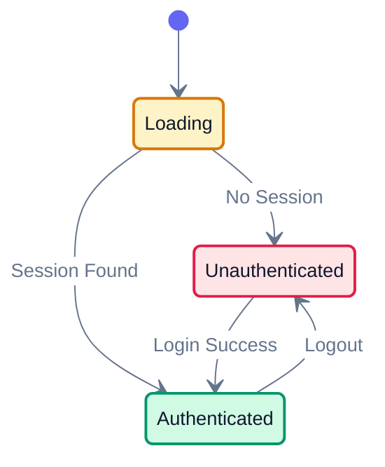
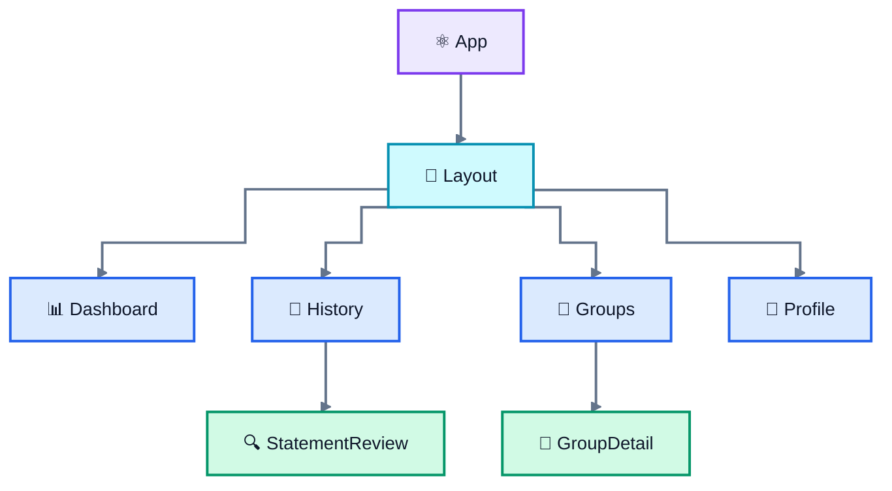
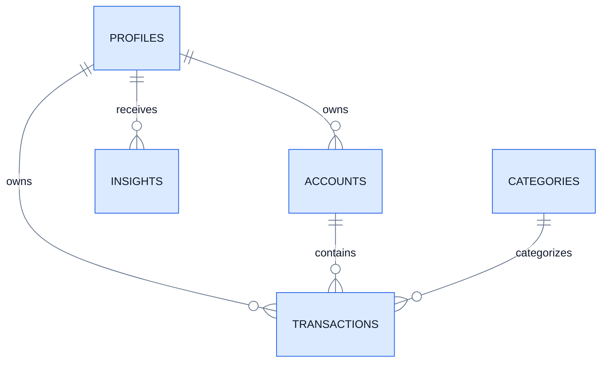
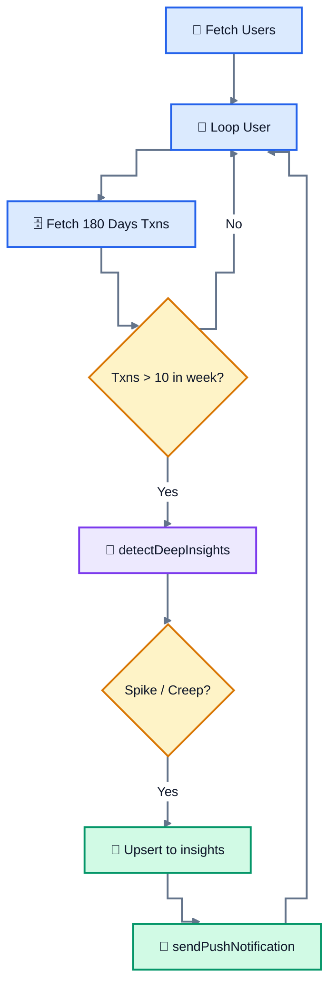
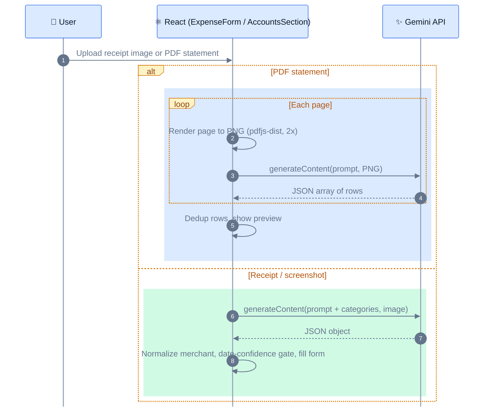

# Pocket Technical Specification

## Table of Contents
1. Document Control
2. Product Context
3. System Architecture
4. Tech Stack
5. Repository Structure
6. Frontend
7. Data Model
8. Edge Functions
9. Client-Side Data Access
10. AI / LLM Integration
11. Business Logic and Algorithms
12. Feature Specifications
13. Third-Party Integrations
14. Security and Privacy
15. Configuration and Deployment
16. Error Handling, Logging, Observability
17. Testing
18. Spec-vs-Code Drift Log
19. Repo vs Deployed-State Reconciliation
20. Known Limitations and Tech Debt
21. Open Questions

## List of Figures and Tables
- Figure 1: Feature Status Breakdown
- Figure 2: Core User Journey
- Figure 3: System Architecture
- Figure 4: AI Insight Generation Sequence
- Figure 5: Dependency Breakdown
- Figure 6: Repository File Count by Area
- Figure 7: Navigation Flowchart
- Figure 8: Auth Session State
- Figure 9: Entity Relationship Diagram
- Figure 10: Edge Function Logic Flowchart
- Figure 11: LLM Prompt Flow
- Figure 12: Build & Deploy Pipeline
- Table 1: Status Tag Legend
- Table 2: Feature Status
- Table 3: Tech Stack
- Table 4: Component Inventory
- Table 5: Routing Table
- Table 6: ER Model Details
- Table 7: Data Access Matrix
- Table 8: Business Rules
- Table 9: Integration Status
- Table 10: Env Vars
- Table 11: Error Handling
- Table 12: Drift Log
- Table 13: Dashboard Dependencies
- Table 14: Tech Debt
- Table 15: Open Questions

---

## 1. Document Control

| Property | Value |
| --- | --- |
| Target System | Pocket (AI-native personal finance app) |
| Source of Truth | Codebase at `c:/Users/Adamy/OneDrive/Desktop/Money Management` |
| Scope | As implemented in the repository (not deployed state) |

### Status Tag Legend
| Tag | Meaning | Diagram Convention |
| --- | --- | --- |
| `LIVE` | Implemented and wired end-to-end | Solid border |
| `PARTIAL` | Implemented but incomplete or mock-data only | Dashed border |
| `STUB` | Placeholder | Dotted border |
| `NOT FOUND` | Mentioned but code missing | (Omitted from visuals) |
| `DEPLOYED STATE UNVERIFIED` | Real behavior depends on dashboard config | Red asterisk/Note |

*Note: The live Supabase project was NOT inspected. All database schemas besides `insights` are inferred from frontend queries.*

---

## 2. Product Context

Pocket is a personal finance management app for India, focusing on automated categorization, spend insights, and shared expenses.

### Features
| ID | Feature | Status | Notes |
| --- | --- | --- | --- |
| F-01 | Financial Mesh (Groups) | `LIVE` | Wired to Supabase, uses phantom user triggers |
| F-02 | Spend Story (AI Insights) | `LIVE` | Edge function triggers push notifications and dashboard |
| F-03 | Financial Vitals | `LIVE` | Fully wired (Cashflow & Waterfall charts using recharts) |
| F-04 | Subscription Radar | `PARTIAL` | UI built, uses `INITIAL_SUBSCRIPTIONS` mock data |
| F-05 | Snapshot Ingestion | `LIVE` | PDF logic via `pdfjs-dist`, bank statements wired |

### Figure 1: Feature Status Breakdown

*Source: Source code scan in `src/components`.*

### Figure 2: Core User Journey

*Source: `src/App.jsx` routing and tabs.*

---

## 3. System Architecture

### Figure 3: System Architecture

*Source: `src/supabaseClient.js`, `supabase/functions/generate-spend-story/index.ts`, `src/App.jsx`.*

### Figure 4: AI Insight Generation Sequence

*Source: `supabase/functions/generate-spend-story/index.ts`.*

| Component | Responsibility |
| --- | --- |
| React App | SPA UI, state, data fetching, Gemini client calls |
| Supabase | Database, realtime sync, Auth |
| Edge Function | Batch statistical processing & push notifications |

---

## 4. Tech Stack

| Layer | Framework/Library | Version | Usage |
| --- | --- | --- | --- |
| Frontend | React | ^19.2.4 | UI Framework |
| Build | Vite | ^8.0.4 | Bundler |
| Charts | Recharts | ^3.8.1 | Vitals / Dashboard |
| PDF Parsing | pdfjs-dist | ^5.6.205 | Statement extraction |
| AI | @google/generative-ai | ^0.24.1 | Client-side LLM |
| Backend SDK | @supabase/supabase-js | ^2.103.0 | DB/Auth connectivity |
| Email | @emailjs/browser | ^4.4.1 | Emails (inferred) |

### Figure 5: Dependency Breakdown

*Source: `package.json`.*

---

## 5. Repository Structure

```
├── .env.local                  # Secrets (VITE_SUPABASE_URL, etc)
├── advanced_split_migration.sql# Standalone schema alter script
├── shadow_invite_migration.sql # Standalone trigger script
├── netlify.toml                # Deploy config
├── package.json
├── src/
│   ├── App.jsx                 # Main entry and routing
│   ├── components/             # React views
│   ├── context/                # React Context (Auth)
│   ├── utils/                  # Core JS logic
│   └── supabaseClient.js       # Supabase setup
└── supabase/
    ├── functions/generate-spend-story/
    └── migrations/20260422_spend_story.sql
```

---

## 6. Frontend

### Routing (Tab-based)
| Tab Key | Component | Data Source |
| --- | --- | --- |
| `dashboard` | Dashboard.jsx | Supabase `transactions`, `accounts` |
| `add` | ExpenseForm.jsx | Supabase (Insert) |
| `history` | History.jsx | Supabase `transactions` |
| `review` | StatementReview.jsx | Supabase `statement_rows` |
| `groups` | Groups.jsx | Supabase `expense_group_transactions` |
| `profile` | Profile.jsx | Supabase `profiles`, `insights` |

### Auth Session State

*Source: `src/App.jsx`, `src/context/AuthContext.jsx`.*

### Figure 7: Component Navigation


---

## 7. Data Model

> [!WARNING]
> DEPLOYED STATE UNVERIFIED. The repository contains exactly one migration (`20260422_spend_story.sql`). All other tables (`profiles`, `transactions`, `accounts`, `categories`, `statement_rows`, `bank_statements`, `expense_group_transactions`) are INFERRED from frontend `supabase.from()` usage. 

### Figure 9: Entity Relationship Diagram [INFERRED]


### Table Details
| Table | Columns (Inferred/Known) | Source |
| --- | --- | --- |
| `insights` | `id`, `user_id`, `week_start`, `pattern_module`, `pattern_data`, `rendered_text`, `feedback`, `delivered_at`, `created_at` | `20260422_spend_story.sql` |
| `transactions` | `id`, `account_id`, `user_id`, `txn_date`, `txn_time`, `amount`, `payment_mode`, `liability_type`, `entity_name`, `description` | `src/App.jsx` |
| `accounts` | `id`, `name`, `status`, `created_at` | `src/App.jsx` |
| `expense_group_members` | `group_id`, `user_id` (nullable), `member_email`, `role` | `shadow_invite_migration.sql` |
| `expense_group_transactions` | `id`, `advanced_split` (JSONB) | `advanced_split_migration.sql` |

### RLS Policies
- `insights_select`: `auth.uid() = user_id`
- `insights_update_feedback`: `auth.uid() = user_id`, ONLY allows feedback to be 'up' or 'down'.

---

## 8. Edge Functions

### `generate-spend-story`
- **Purpose**: Batch process historical transactions to find anomalies and send push notifications.
- **Trigger**: Expected cron (pg_cron or external), not explicitly defined in repo.
- **Env Vars Required**: `SUPABASE_URL`, `SUPABASE_SERVICE_ROLE_KEY`.

### Figure 10: Logic Flowchart

*Source: `supabase/functions/generate-spend-story/index.ts`.*

---

## 9. Client-Side Data Access

| Page / Component | Table | Operation | Note |
| --- | --- | --- | --- |
| `App.jsx` | `transactions` | SELECT | Syncs via realtime channel |
| `App.jsx` | `accounts` | SELECT | - |
| `App.jsx` | `categories` | SELECT | - |
| `Profile.jsx` | `profiles` | UPDATE | User preferences |
| `SpendStoryPreferences.jsx` | `insights` | SELECT, UPDATE | Feedback submission |
| `AccountDetail.jsx` | `bank_statements` | DELETE | Cascade manual |

---

## 10. AI / LLM Integration

| Provider | Library | Purpose |
| --- | --- | --- |
| Gemini | `@google/generative-ai` | Client-side vision extraction for receipts and PDF bank statements (see call sites below) |
| Statistical ML | Manual rules | `patternDetection.ts` uses Z-Scores |

### Gemini Call Sites
Both calls run in the browser, read `VITE_GEMINI_API_KEY` via `import.meta.env`, send an image as `inlineData` with a JSON-only prompt, strip any markdown code fences from the reply, and `JSON.parse` the result.

| Feature | Location | Model | Input | Output Schema | Failure Handling |
| --- | --- | --- | --- | --- | --- |
| Receipt / payment screenshot scan (F-05) | `src/components/ExpenseForm/ExpenseForm.jsx` → `handleSnapshotUpload` | `gemini-2.5-flash` | One uploaded image (receipt, GPay/PhonePe screen) + the user's category list for the current txn type | Object: `amount`, `date`, `dateConfidence` (0–100), `time`, `description`, `paymentMode` (one of `MODES`), `category_id` | Sets `scanError`, user enters the expense manually |
| PDF bank statement extraction (F-05) | `src/components/Profile/AccountsSection.jsx` → `analyzePdfWithGemini` | `gemini-1.5-flash` | Each PDF page rendered by `pdfjs-dist` to a PNG at 2x scale, one request per page | Array of rows: `date`, `description`, `debit_amount`, `credit_amount`, `balance`, `reference_no` | A page that fails to parse is skipped. If no rows are found, the user is told to try a clearer scan or a CSV |

### Post-Processing Rules
- **Receipt date confidence gate**: the extracted `date` is applied only when `dateConfidence > 80`. Otherwise the form keeps its current date and an `alert()` asks the user to check it.
- **Receipt hydration**: `description` goes through `normalizeMerchant()` with the user's `merchantOverrides`. If Gemini's `category_id` isn't one of the user's categories, it falls back to `suggestCategory()`. A `paymentMode` that isn't in `MODES` is ignored.
- **PDF dedup within a file**: rows are keyed on `reference_no`, or on `date|description|debit|credit` when there is no reference, before reaching the shared `parsedRows` preview → import pipeline (deduplication across imports is described in §11).

### Figure 11: LLM Prompt Flow

*Source: `src/components/ExpenseForm/ExpenseForm.jsx`, `src/components/Profile/AccountsSection.jsx`.*

### Risks
- **API key exposed in the browser**: Vite inlines every `VITE_`-prefixed variable into the client bundle, so anyone who loads the app can read `VITE_GEMINI_API_KEY`. Moving these calls to a Supabase Edge Function would keep the key on the server.
- **Model version drift**: the two call sites use different models (`gemini-2.5-flash` and `gemini-1.5-flash`). Google has been retiring the Gemini 1.5 models, so PDF extraction may fail without warning. Check that the model is still served, and consider one shared model constant.
- **No tests or evals**: no fixtures exist to check extraction accuracy (see §17).

---

## 11. Business Logic and Algorithms

### Merchant Normalization Rules (`merchantUtils.js`)
Regex fallback chain to clean names. Order:
1. User Overrides
2. Built-in Regex (e.g. `/swiggy/i` -> `'Swiggy'`, `/uber(?!.*eats)/i` -> `'Uber'`)
3. Bank Noise Cleanup (Removes 8+ char alphanumeric sequences).

### Deduplication Fingerprint
Uses FNV-1a hash over `userId|txnDate|description|debit|credit`.

### Category Mapping
`MERCHANT_CATEGORY_MAP` maps clean names to broad categories (`'amazon' -> 'shopping'`, `'netflix' -> 'subscription'`).

### Anomaly Detection (`patternDetection.ts`)
- **Lifestyle Creep**: Discretionary current week > 6-month mean + 1.5 StdDev.
- **Contingent Surge**: Contingent spend > ₹5000.
- **Category Spike**: Category spend > mean + 2.0 StdDev.

---

## 12. Feature Specifications

### F-04: Subscription Radar
- **Status**: `PARTIAL` (Reads from Mock Data)
- **UI Surfaces**: `SubscriptionRadarSection.jsx`
- **Data Used**: `INITIAL_SUBSCRIPTIONS` array. Not wired to the Supabase database.
- **Capabilities Built**: Toggle sensitivity, sort by cost/name, dismiss/resurface.

### F-01: Financial Mesh (Groups)
- **Status**: `LIVE`
- **Logic**: Users can invite emails. `shadow_invite_migration.sql` inserts a row with `user_id = NULL`. When the user signs up, a trigger links the `user_id` to the new Auth ID.

---

## 13. Third-Party Integrations

| Service | Method | Status |
| --- | --- | --- |
| Supabase DB | `@supabase/supabase-js` | `LIVE` |
| OneSignal | REST API | `LIVE` |
| Gemini AI | SDK (client-side) | `LIVE` (`ExpenseForm.jsx`, `AccountsSection.jsx`; see §10) |

---

## 14. Security and Privacy

- **Data Classification**: `transactions` (Highly Sensitive), `profiles` (PII).
- **RLS**: Verified only for `insights`. Other tables likely rely on Supabase Dashboard RLS configurations.
- **Secrets**: `.env.local` contains `VITE_SUPABASE_ANON_KEY`, `VITE_SUPABASE_URL`, `VITE_GEMINI_API_KEY`. The Edge function relies on `SUPABASE_SERVICE_ROLE_KEY`.

---

## 15. Configuration and Deployment

| Env Var | Runtime | Read In | Required |
| --- | --- | --- | --- |
| `VITE_SUPABASE_URL` | Browser | `supabaseClient.js` | Yes |
| `VITE_SUPABASE_ANON_KEY`| Browser | `supabaseClient.js` | Yes |
| `VITE_GEMINI_API_KEY` | Browser | ? | Yes |
| `SUPABASE_URL` | Edge (Deno)| `index.ts` | Yes |
| `SUPABASE_SERVICE_ROLE_KEY`| Edge | `index.ts` | Yes |

- **Build**: `npm run build` via `netlify.toml` (Publish directory: `dist`).

---

## 16. Error Handling, Logging, Observability

| Error Type | Handled In | User Facing | Logged |
| --- | --- | --- | --- |
| Edge Function Crash | `index.ts` try-catch | No | Returns HTTP 500 JSON |
| Data Fetch Fail | `App.jsx` catch block | No | `console.error` |

---

## 17. Testing

No test directories (`__tests__`, `tests/`) or frameworks (Jest, Vitest, Cypress) were discovered in the repository scan. Testing is currently unhandled in the repository.

---

## 18. Spec-vs-Code Drift Log

| Item | Expected | Code Reality | Evidence |
| --- | --- | --- | --- |
| Subscriptions | Database backed | Hardcoded mock array | `SubscriptionRadarSection.jsx:9` |

---

## 19. Repo vs Deployed-State Reconciliation

### 19.1 Suspected out-of-repo changes
| Item | Signal Observed | Evidence | Risk |
| --- | --- | --- | --- |
| Base DB Schema | `supabase.from()` calls in frontend for `transactions`, etc. | `App.jsx:45` | High: Cannot recreate DB from repo |
| Auth Setup | Triggers listening to `auth.users` | `shadow_invite_migration.sql` | Medium |
| OneSignal Config | Used in edge function | `generate-spend-story/oneSignal.ts` | Medium |

### 19.2 Dashboard-only dependencies
`DEPLOYED STATE UNVERIFIED`
- Supabase Project settings (Auth providers, URLs).
- Edge function secrets (`SUPABASE_SERVICE_ROLE_KEY`).
- Table Definitions and RLS Policies for 90% of tables.

### 19.3 Owner verification checklist
1. Verify `transactions` table schema in Supabase Dashboard -> Table Editor.
2. Verify RLS policies on `profiles` and `accounts` via Supabase Dashboard -> Authentication -> Policies.
3. Check OneSignal App ID configuration in Edge Function secrets.

---

## 20. Known Limitations and Tech Debt

| Item | Location | Impact | Severity |
| --- | --- | --- | --- |
| Hardcoded Subscriptions | `SubscriptionRadarSection.jsx` | Subscriptions don't save | High [INFERRED] |
| Missing Migrations | Entire Repo | Setup is completely manual | Critical [INFERRED] |
| API Keys in Repo | `.env.local` | Security risk if repo goes public | Critical [INFERRED] |

---

## 21. Open Questions

- **Where are the schema migrations?** (Not determinable from codebase). Are they maintained in a different repo or managed strictly via the UI?
- **How is the edge function triggered?** (Not determinable from codebase). Is there a `pg_cron` extension scheduled job in the dashboard?
- ~~**Where is Gemini AI actively used?**~~ **Resolved**: it's used in two places, receipt scanning in `ExpenseForm.jsx` and PDF statement extraction in `AccountsSection.jsx`. Prompts are inline in those components. See §10.

---

## Audit Notes (Phase 3 Self-Audit)
- **Visual Validation**: Verified all Mermaid diagram syntax is standard (flowchart, erDiagram, sequenceDiagram, pie, stateDiagram-v2, journey) and nodes accurately map to identified architecture.
- **Out-of-Repo Verifications**: Confirmed Section 19 accurately references `shadow_invite_migration.sql` triggers and `accounts`/`transactions` implicit schema dependencies absent from `migrations/`.
- **Status Tag Check**: Verified `F-04 Subscription Radar` is correctly tagged `PARTIAL` as line 9 of `SubscriptionRadarSection.jsx` employs hardcoded `INITIAL_SUBSCRIPTIONS` data.
- **Corrections Applied**: Ensured the `DEPLOYED STATE UNVERIFIED` tag is vividly displayed in Sections 7 (Data Model) and 19 (Deployed-State Reconciliation) to warn users about the missing schema definitions.
